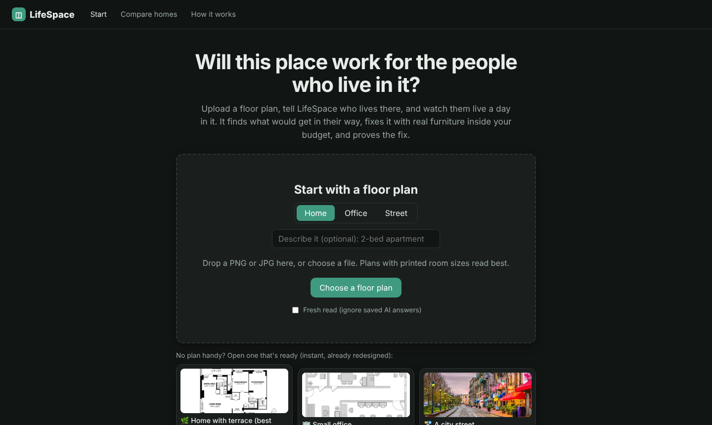
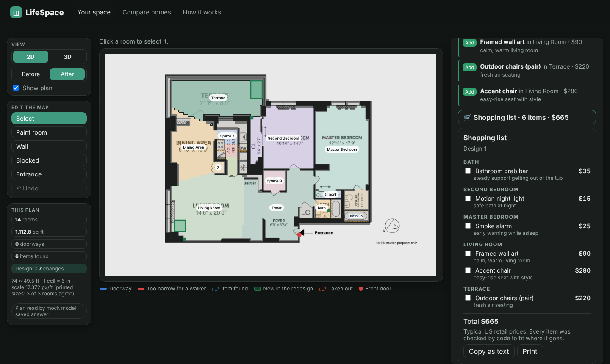
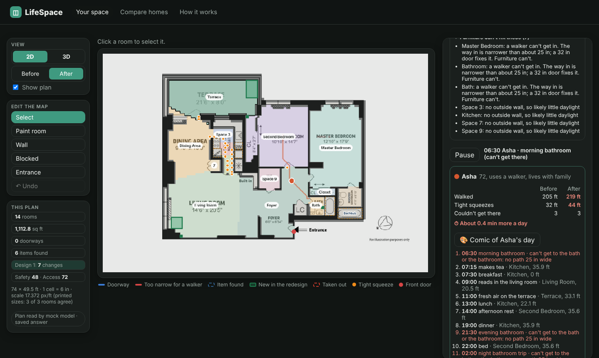
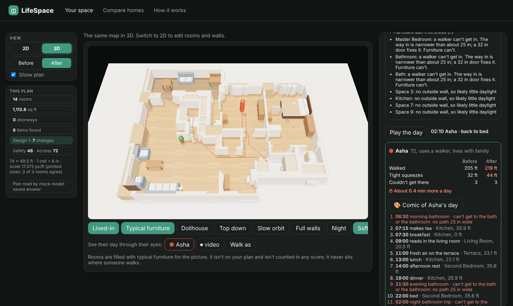
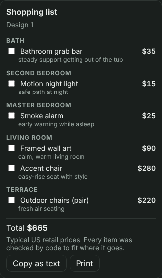
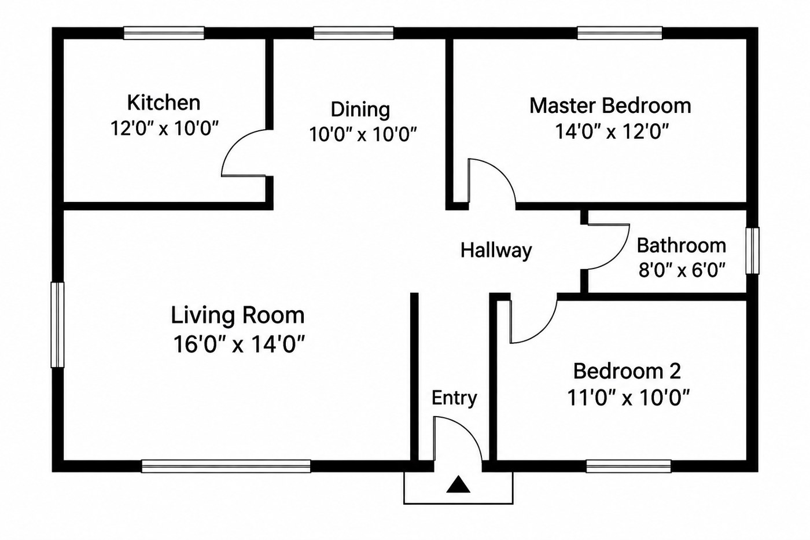
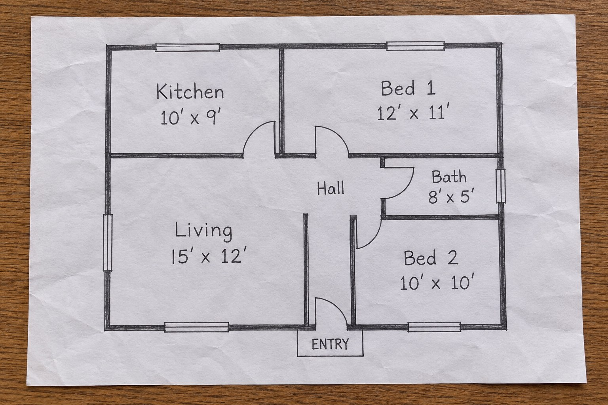
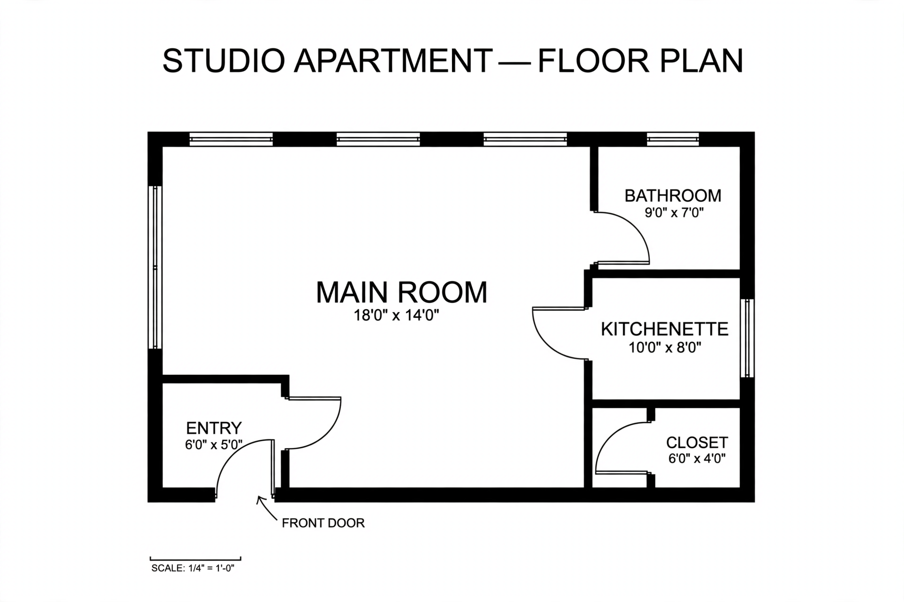
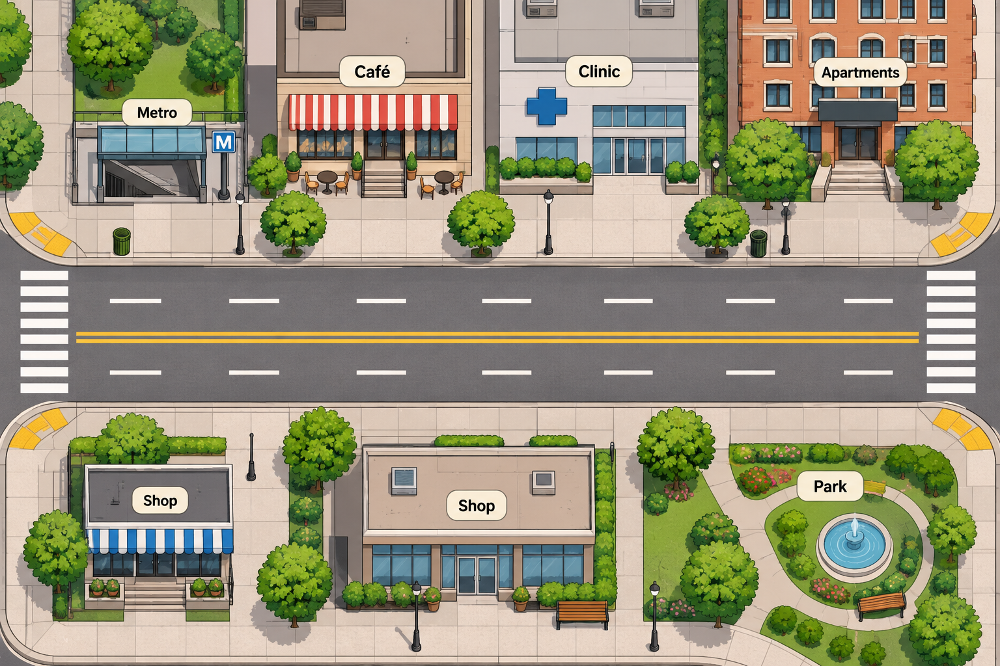

# LifeSpace

**Design any space. Watch AI people live in it.**

**Live:** https://lifespace.mokshadsankhe.me

Upload a home floor plan, an office layout or a street. Redesign it with real, common items only. Then a cast of AI people lives a day in the old space and the new one. A scorecard and each person's own words show what changed.

Built for the Meta Global AI Developer Hackathon (Oct 26 to Nov 4, 2026), Indie track, theme "Build for Your World". Everything in this repo was built during the hackathon.

> LifeSpace gives design and livability signals only. It is not medical or health advice.



## Why

A floor plan never tells you that a 72-year-old with a walker can't get through the bathroom door at 2 AM. LifeSpace does. You see her day before you spend a dollar.

## What it does

1. **Read the plan.** Walls, doors (measured in inches), rooms, printed sizes and furniture. An **AI plan check** finds misreads and fixes them with you. It also learns from your fixes.
2. **Tell it who lives there.** "My mom is 72 and uses a walker." Each person gets a real body width and a daily routine. Add a dog, a toddler, a caregiver or a delivery.
3. **Redesign on a budget.** Real, common items only. Every idea is checked by code: does it fit, can it get through the door, does it block anyone? Compare 3 budgets side by side.
4. **Watch them live it.** The same day before and after, on the 2D map or in 3D. Ride along, walk as them, or switch to night mode.
5. **What if…** In 5 years (a walker becomes a wheelchair), a fire drill at 2 AM, talk to each person, a comic of their day, or your own room photo with the redesign in it.
6. **Shopping list.** The redesign as a checklist with prices. Tick, copy or print it.
7. **Compare homes** and **check a street**.









## AI suggests. Code checks.

The AI is great at ideas and bad at inches. So LifeSpace never trusts a number from the model.

- Muse Spark suggests a grab bar, a wider door or a moved sofa.
- Code checks every idea: the size, the clearance and the path through each door.
- People walk real paths on a grid at their real width. Squeezes, dead ends and minutes lost are measured, not guessed.
- When furniture can't fix something (a 19 in door), LifeSpace says so. It shows what a 32 in door would change.
- Ideas that fail the checks are dropped and listed, so you can see why.

## How each Meta model is used

| Model | What it does in LifeSpace |
| --- | --- |
| **Muse Spark 1.3** (Meta Model API) | Reads plans and photos (vision), runs the AI plan check, writes redesigns, gives each AI person a voice and a routine, answers "talk to them" and plain questions |
| **Muse Image** | Room pictures, the comic of a person's day, and editing your own room photo to show the redesign. The sample plans and streets were made with Muse Image too |
| **SAM 3.1** | Finds furniture on plans, and lights, benches and bins on street photos |
| **Muse Spark Open** on Baseten (`meta-models/muse-spark-open-1026`) | Backup if the main API is slow or down |

Every AI call goes through one model router (`backend/app/router/model_router.py`). If a provider fails or returns bad JSON, the next one answers. Every answer is cached, so repeat runs cost nothing.

| `MODE` | Chat chain | Image chain | Use it for |
| --- | --- | --- | --- |
| `mock` | canned answers | grey PNG | tests, offline UI work |
| `local` | Ollama → Cloudflare | Cloudflare | daily development, free |
| `prod` | Meta → Baseten → Cloudflare | Meta → Cloudflare | the live site |

## Sample plans

The samples in `docs/samples/` were generated for this project with Muse Image and ChatGPT. No real homes or private plans are used.

| | |
| --- | --- |
|  |  |
|  |  |

## Known limits

- **Clean plans read best.** Plans with printed room sizes and clear walls work well. Busy plans with textured floors or photos at an angle may need the AI plan check or a few hand fixes.
- **Meta calls can take up to about a minute** on a big plan. Results are cached after that.
- **The free server sleeps.** A pinger keeps it awake, but the first load after a long break can be slow.
- **Prices are typical US retail**, not live quotes.
- The live site has a daily limit per visitor to protect the free credits.

## How it's deployed

```
Browser ── Cloudflare Pages (React + Three.js)
              │  API calls go direct
              ▼
           Render (FastAPI in Docker) ── Meta Model API / Baseten
              │
              ▼
           Supabase Storage (saved spaces, cache, lessons)

GitHub Actions: tests, keepalive, backend image, nightly demo prep, weekly storage cleanup
UptimeRobot: health ping every 5 minutes
```

## Run it

See [docs/SETUP.md](docs/SETUP.md) for local setup and [docs/DEPLOY.md](docs/DEPLOY.md) for the live site.

```bash
# backend
cd backend
python -m venv .venv && source .venv/bin/activate   # Windows: .venv\Scripts\activate
pip install -r requirements.txt
cp ../.env.example ../.env                           # then fill in keys
uvicorn app.main:app --reload --port 8000

# frontend (new terminal)
cd frontend
npm install
npm run dev                                          # http://localhost:5173
```

## Project layout

```
backend/
  app/
    main.py              FastAPI app
    router/              model router, providers, disk cache
    space/               plan reading, plan doctor, lessons, paths
    api/                 spaces, samples, streets
  data/packs/            home, office, street packs (catalog, people)
  scripts/               smoke test, demo prep, storage cleanup
  tests/                 offline tests
  Dockerfile             the backend on Render (render.yaml at the repo root)
frontend/                React + Vite + Three.js
  functions/api/         Cloudflare Pages Function: /api → Render
.github/workflows/       tests, keepalive, image, prepare-demo, cleanup-storage
docs/                    setup, deploy, screenshots, sample plans
```
